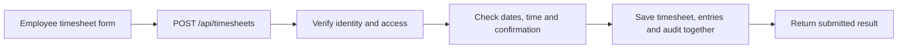
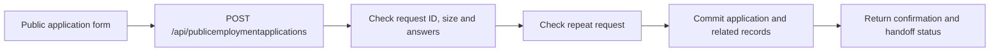
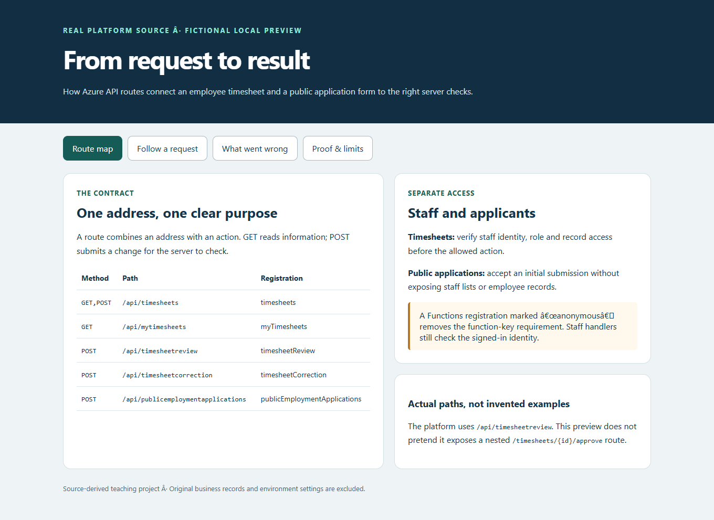
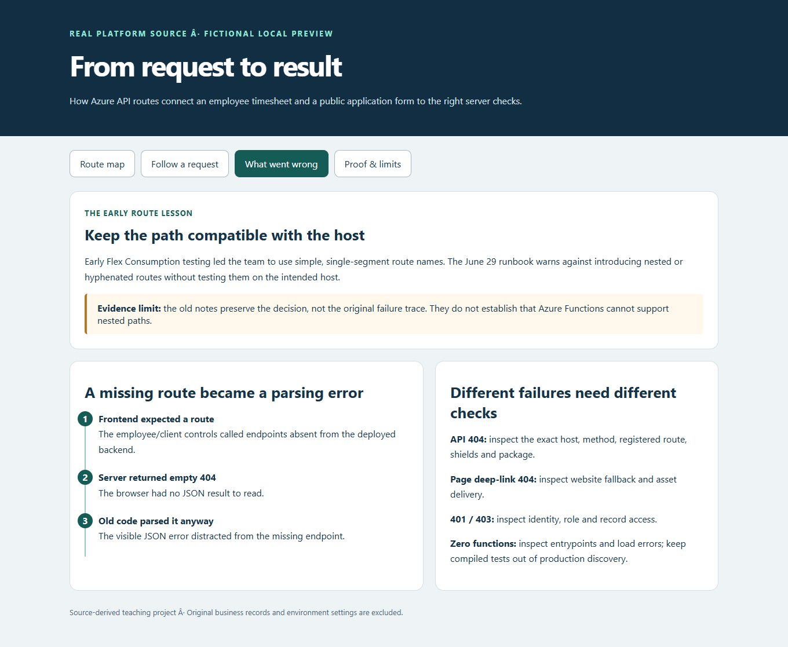

# Azure API Routes: Timesheets and Public Applications

An API route is the address and action a website uses to ask its server to do something. This project shows how real workforce-platform routes accept timesheets, restrict staff access and receive public job applications.

## The business problem

Employees need to submit their time, supervisors need to review it and applicants need to apply without receiving a staff account. These processes share a website but have different rules about who may act, which person's records may be accessed and what must be saved together.

If the website calls a route that the deployed backend does not expose, users can encounter a broken form or an unhelpful response-parsing error. If access checks rely only on what the page displays, a caller may attempt the same request directly. Repeated application submissions and invalid timesheet answers also need deliberate handling.

The business need was a clear server entry point for each action, with consistent validation, record-level access and responses that tell the website what actually happened.

## The solution

Use explicit Azure Functions routes with shared checks and clear responses. Keep public application submission separate from staff listing, review and employee records.

## Tools Used and What They Do

| Tool or service | What it does | Where it fits |
| --- | --- | --- |
| Azure Functions v4 SDK | Map HTTP paths and methods to their handlers. | Actual registrations preserved in the selected route references. |
| Node.js and TypeScript | Run the API and express its request rules. | Actual implementation; the local build extracts selected pure functions. |
| mssql | Send SQL queries and transactions from the Node.js handlers. | Actual reference imports; SQL connections and writes are not executed here. |
| Microsoft Entra ID | Supply the staff identity checked by protected handlers. | Actual application boundary; local tests do not verify real bearer tokens. |
| React | Collect form answers and initiate requests in the platform website. | Frontend context; this repository is a route workbench, not the full React app. |
| TypeScript compiler and Node test runner | Extract/transpile validators and run the selected tests. | Local validation; not complete handler typechecking or Functions-host discovery. |

The loopback preview explains the request path without submitting applications, saving timesheets or sending messages.

## Step by Step

Your own HTTP server with a public application-validation route, health route and a closed staff-route boundary.

[Open the standalone build guide](docs/BUILD-YOUR-OWN.md) or follow the same complete instructions below.

Start with a new folder, your own files and your own accounts. The numbered steps below describe the build; no portfolio repository checkout is required. The existing implementation/evidence elsewhere in this repository is a separate reference, not a claim that your new build has already passed.

### Prerequisites

Node.js, a text editor and a terminal; no Azure account is required for this route-focused build. Staff sign-in, persistence and actual application submission are separate additions, not features hidden in this sample.

Use Bash on Linux/macOS/WSL for Bash blocks and PowerShell for PowerShell blocks. Select the tool versions supported by the official sources below, record the versions you actually install and retain generated dependency locks. Cloud resources, scanner downloads, logs and external AI calls can create costs; review the stated scope before enabling them.

### Create your project folder

Choose a new folder name. These first commands create a blank project; an optional `git init` gives it its own history. Create parent directories in your editor when a later step introduces a nested file.

```bash
mkdir my-azure-api-routes
cd my-azure-api-routes
git init
```

Create `.gitignore` before saving credentials or build outputs:

```gitignore
.venv/
node_modules/
.env
.env.*
local.settings.json
credentials.json
token.json
*.pem
*.key
*.tfstate*
*.tfplan
.terraform/
private*/
captures/
backups/
batch.json
reports/
out/
app-config.local.yaml
```

The source/file snippets are a starting implementation you type or paste into the named files. Replace `YOUR_*`, names, regions and addresses only with values from your own lab; do not place real client/employee records in a test project. Keep your terminal in this project root unless a step explicitly changes directory.

Before a first commit, set your own repository-local author with `git config user.name "YOUR_NAME"` and `git config user.email "YOUR_PUBLIC_COMMIT_EMAIL"`. Review `git status --short` and the staged diff before publishing; ignored local files are not a substitute for reviewing what you upload.

### Step 1 — Define your route contract

**Where:** A new routes.md file.

Write GET /api/health, POST /api/applications and the protected /api/timesheets boundary. Specify 400 for broken JSON, 422 for invalid application fields, 413 for oversized input, 401 for missing staff authentication and 404 for unknown paths. Require application/json on the POST route and record 415 for an unsupported content type.

**Check before continuing:** You have a route/method/status table before writing handlers.

### Step 2 — Create the server

**Where:** Your new project folder.

Create server.mjs below. The example validates fictional application input but deliberately does not save applications or pretend that a header supplied by a browser proves a staff role.

Create **`server.mjs`** with the following contents:

```javascript
import http from 'node:http';
const server = http.createServer(async (req, res) => {
  const send = (status, value) => {
    res.writeHead(status, {'content-type': 'application/json'});
    res.end(JSON.stringify(value));
  };
  if (req.method === 'GET' && req.url === '/api/health')
    return send(200, {service: 'my-api', status: 'ok'});
  if (req.method === 'POST' && req.url === '/api/applications') {
    if ((req.headers['content-type'] || '').split(';')[0].trim().toLowerCase() !== 'application/json')
      return send(415, {error: 'Use Content-Type: application/json'});
    let chunks = [], bytes = 0, tooLarge = false;
    try {
      for await (const chunk of req) {
        bytes += chunk.length;
        if (bytes > 4096) { tooLarge = true; chunks = []; }
        else if (!tooLarge) chunks.push(chunk);
      }
    } catch {
      if (req.aborted || res.destroyed || res.writableEnded) return;
      return send(400, {error: 'Request body could not be read; check the connection'});
    }
    if (tooLarge) return send(413, {error: 'Request too large'});
    const raw = Buffer.concat(chunks).toString('utf8');
    let body;
    try { body = JSON.parse(raw); }
    catch { return send(400, {error: 'Send valid JSON'}); }
    if (typeof body?.name !== 'string' || !body.name.trim() ||
        body.name.length > 100 || typeof body?.email !== 'string' ||
        body.email.length > 254 || !/^[^\s@]+@[^\s@]+\.[^\s@]+$/.test(body.email))
      return send(422, {error: 'A name and valid email are required'});
    return send(202, {status: 'validated-not-saved'});
  }
  if (req.url === '/api/timesheets')
    return send(401, {error: 'Configure and validate staff authentication before enabling this route'});
  return send(404, {error: 'Route not found'});
});
server.requestTimeout = 10000;
server.headersTimeout = 5000;
server.listen(8080, '127.0.0.1');
```

**Check before continuing:** Your file contains the routes and explicit failure responses.

### Step 3 — Start your own API

**Where:** Terminal in that folder.

Run Node and leave this terminal open. The server binds to your computer only; use a second terminal for the requests in the next step.

```bash
node server.mjs
```

**Check before continuing:** GET /api/health returns JSON with status ok.

### Step 4 — Prove each request path

**Where:** Second terminal in the same folder.

Send the requests below with curl (curl.exe in Windows PowerShell). Record response status and body for each case; 202 here means validated-not-saved, not a database commit. Also send malformed JSON, a body above 4096 bytes and a text/plain request; expect 400, 413 and 415 respectively. These limits and local tests do not replace production rate limiting or authentication.

```bash
curl -i http://127.0.0.1:8080/api/health
curl -i -X POST http://127.0.0.1:8080/api/applications -H 'Content-Type: application/json'   --data '{"name":"Taylor Example","email":"taylor@example.invalid"}'
curl -i -X POST http://127.0.0.1:8080/api/applications -H 'Content-Type: application/json' --data '{}'
curl -i http://127.0.0.1:8080/api/timesheets
curl -i http://127.0.0.1:8080/api/missing
```

**Check before continuing:** The valid body is accepted for validation, the incomplete body is rejected and timesheets remains closed.

### Step 5 — Design the staff and storage additions

**Where:** Your route contract and identity configuration.

Before implementing staff timesheets, define the issuer/audience/signature validation, allowed role and exact employee ownership check. Add a real data transaction and conflict handling before changing validated-not-saved to a saved response; do not open the route with a browser-provided role flag.

**Check before continuing:** The remaining work is explicit and the incomplete staff route stays denied.

### Step 6 — Document and stop the project

**Where:** Your terminal and evidence folder.

Save the route table, server file and observed requests without personal records. Stop Node with Ctrl+C; no cloud deletion is needed for this local build.

**Check before continuing:** Another reader can create the same files and reproduce your response table.

### Verification and your own screenshots

| Evidence | What to record | Your result |
| --- | --- | --- |
| New build | Your own files/resource settings and tool versions | Not yet recorded |
| Working path | The actual successful request, configuration or recovery result | Not yet recorded |
| Failure boundary | A meaningful denied, malformed, stale or failed case | Not yet recorded |
| Recovery / cleanup | What you restored or removed and what remains billed | Not yet recorded |

Capture your own architecture/configuration, one working result and one failure/recovery result. Keep tokens, credentials, personal records and private identifiers out of public screenshots. Existing portfolio images are references, not evidence that you performed these steps.

### Troubleshooting order

1. Confirm the named file, working directory and selected tool/interpreter.
2. Check the exact input and resource/account selected for the failing step.
3. Separate identity permission, network/DNS reachability and application validation.
4. Keep the actual error and reconcile an unknown write outcome before repeating it; do not widen access or repeat paid operations blindly.

The numbered steps describe a build procedure. Local syntax checks, an accepted API request, a completed hosted operation and a human verification are different evidence levels; fill in the verification table with what you actually observed.

### Official implementation references

- [nodejs.org — http.html](https://nodejs.org/api/http.html)
- [learn.microsoft.com — functions-reference-node](https://learn.microsoft.com/en-us/azure/azure-functions/functions-reference-node)

The walkthrough layout follows the prerequisites → creation/configuration → test → verification → troubleshooting → cleanup pattern of the [Splunk project reference](https://github.com/davidharris6/splunk-siem-log-analysis). Its Splunk-specific settings are not copied into unrelated projects.

<details>
<summary>Reference: how the existing platform implementation operates</summary>

1. **Choose the route (Azure Functions).** Match the request address and HTTP method to the registered handler. Reading a list and submitting a form are separate actions even when they use the same address.
2. **Check access and answers (Entra and validators).** Staff requests require a verified identity and the right access to the selected record. Public applications use their own submission checks without giving applicants a staff account.
3. **Save the allowed change (SQL transactions).** The live implementation checks the current record and saves related changes together in SQL. Its response tells the website what happened, while email delivery remains a separate outcome.
4. **Prove the boundary (Node test runner).** Run the source validators against fictional examples and inspect the registered routes. Keep local validation evidence separate from real sign-in, database writes and delivery testing.

</details>

## What was built

| Request | What it does | Required application role |
|---|---|---|
| `GET /api/mytimesheets` | Read the employee's timesheets | Caregiver or Admin |
| `GET /api/timesheets` | List timesheets for staff review | Supervisor, Admin or HR |
| `POST /api/timesheets` | Submit a timesheet | Caregiver or Admin |
| `POST /api/timesheetreview` | Record a review | Supervisor or Admin |
| `POST /api/timesheetcorrection` | Submit an allowed correction | Caregiver, Admin or HR |
| `POST /api/publicemploymentapplications` | Submit an initial job application | No staff role |

Role names alone do not grant access to every record. The implementation also checks employee ownership, team access, assignments and allowed status changes where applicable; the [route guide](docs/ROUTES.md) explains the differences.





## Proof it works

The local suite passes **26 tests**, including the 15 selected original application-contract tests. The demo calculates an eight-hour fictional timesheet, limits a requested page size of 200 to 100 and parses a fictional application using the extracted source validators.




These screenshots show the local teaching preview. They do not show production records or prove real authentication, SQL permissions, concurrent writes or email receipt.

## A real issue and what it taught us

Early Flex Consumption testing led this platform to use simple, single-segment routes such as `/api/shiftnotereview`. The old records warn against introducing nested or hyphenated paths without testing them on the actual host; they do not preserve enough evidence to identify the original root cause or establish a general Azure limitation.

A separate incident involved a frontend expecting employee/client routes absent from its deployed backend. The resulting empty 404 response then caused a misleading JSON parsing error. See [the historical investigation and troubleshooting sequence](docs/ROUTE-TROUBLESHOOTING.md).

## Run it locally

Use Node.js 22.23.2 or later, then run:

```bash
npm ci --ignore-scripts
npm test
npm run demo
npm run preview
```

Open the local preview at `http://127.0.0.1:8145`. These commands do not connect to Azure, submit applications, save timesheets or send email.

## Strengths, limits and tradeoffs

- **Strength:** real route registrations and validators make the examples traceable to working platform code.
- **Strength:** public submission and staff records have separate access boundaries.
- **Tradeoff:** action names such as `timesheetreview` are easy to map to existing handlers but less resource-oriented than nested REST designs.
- **Limit:** this is a selected source reference and local validator workbench, not a complete deployable backend or authentication emulator.
- **Scale:** bound list sizes, index common database filters and monitor slow calls; server scaling still depends on SQL capacity, connection management and downstream limits.

## Explore the details

- [Routes, access and request flow](docs/ROUTES.md)
- [Historical route failures and troubleshooting](docs/ROUTE-TROUBLESHOOTING.md)
- [Commands and response handling](docs/COMMANDS.md)
- [Operations, security and scaling](docs/OPERATIONS.md)
- [Source and validation evidence](docs/VALIDATION.md)
- [Actual selected handler source](reference/routes/)
- [Deploying the Node.js API](https://github.com/truthofsource/azure-nodejs-api-deployment)
- [Business rules and reliable saves](https://github.com/truthofsource/api-business-logic-and-workflow-controls)

The manual-only validation workflow runs only when dispatched. Publishing this portfolio does not start an Actions run or deploy platform resources.
