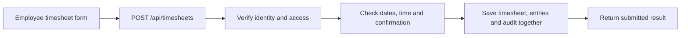
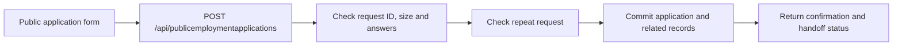
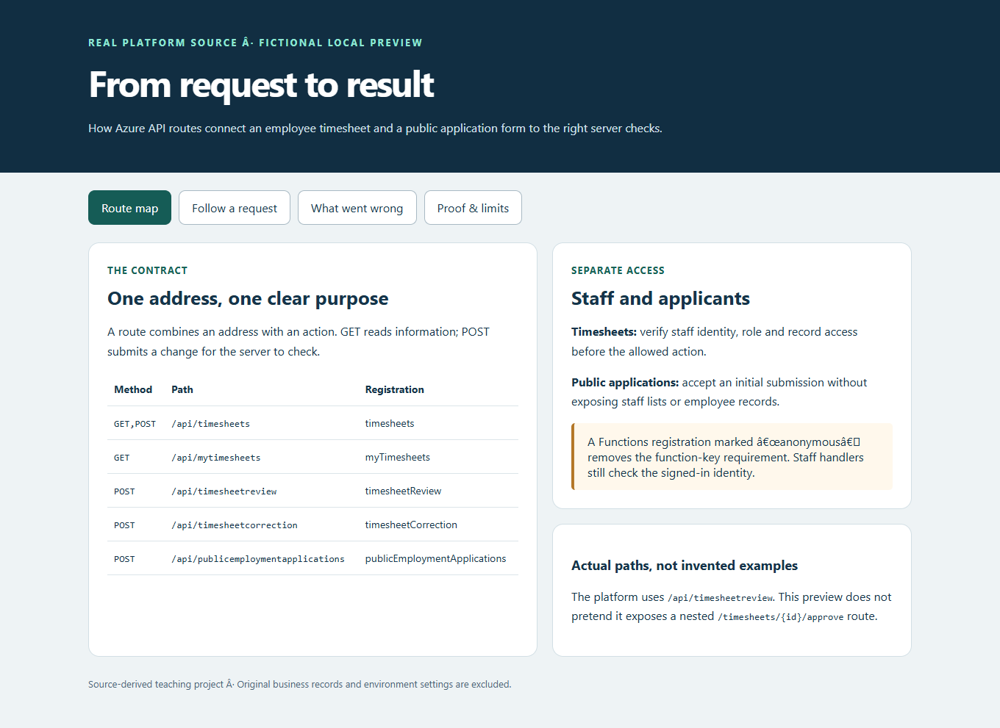
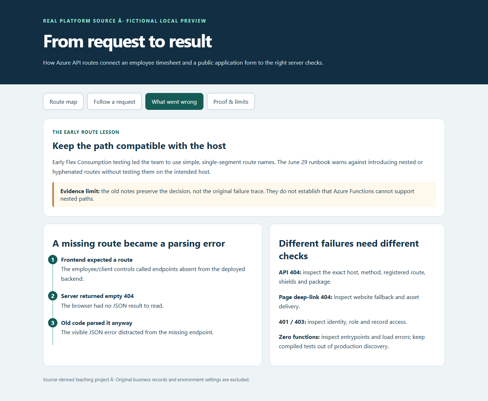

# Azure API Routes: Timesheets and Public Applications

An API route is the address and action a website uses to ask its server to do something. This project shows how real workforce-platform routes accept timesheets, restrict staff access and receive public job applications.

## The business problem

Employees need to submit their time, supervisors need to review it, and applicants need to apply without receiving staff access. A button on a website is not enough: the server must decide who may act, check the answers and save the right records.

## The solution

Use explicit Azure Functions routes with shared checks and clear responses. Keep public application submission separate from staff listing, review and employee records.

## Step by step

1. **Choose the route.** Match the request address and HTTP method to the registered handler. Reading a list and submitting a form are separate actions even when they use the same address.
2. **Check access and answers.** Staff requests require a verified identity and the right access to the selected record. Public applications use their own submission checks without giving applicants a staff account.
3. **Save the allowed change.** The live implementation checks the current record and saves related changes together in SQL. Its response tells the website what happened, while email delivery remains a separate outcome.
4. **Prove the boundary.** Run the source validators against fictional examples and inspect the registered routes. Keep local validation evidence separate from real sign-in, database writes and delivery testing.

## What was built

| Request | What it does | Required application role |
|---|---|---|
| `GET /api/mytimesheets` | Read the employee's timesheets | Caregiver or Admin |
| `GET /api/timesheets` | List timesheets for staff review | Supervisor, Admin or HR |
| `POST /api/timesheets` | Submit a timesheet | Caregiver or Admin |
| `POST /api/timesheetreview` | Record a review | Supervisor or Admin |
| `POST /api/timesheetcorrection` | Submit an allowed correction | Caregiver, Admin or HR |
| `POST /api/publicemploymentapplications` | Submit an initial job application | No staff role |

Role names alone do not grant access to every record. The implementation also checks employee ownership, team access, assignments and allowed status changes where applicable; the [route guide](docs/ROUTES.md) explains the differences.





## Proof it works

The local suite passes **26 tests**, including the 15 selected original application-contract tests. The demo calculates an eight-hour fictional timesheet, limits a requested page size of 200 to 100 and parses a fictional application using the extracted source validators.




These screenshots show the local teaching preview. They do not show production records or prove real authentication, SQL permissions, concurrent writes or email receipt.

## A real issue and what it taught us

Early Flex Consumption testing led this platform to use simple, single-segment routes such as `/api/shiftnotereview`. The old records warn against introducing nested or hyphenated paths without testing them on the actual host; they do not preserve enough evidence to identify the original root cause or establish a general Azure limitation.

A separate incident involved a frontend expecting employee/client routes absent from its deployed backend. The resulting empty 404 response then caused a misleading JSON parsing error. See [the historical investigation and troubleshooting sequence](docs/ROUTE-TROUBLESHOOTING.md).

## Run it locally

Use Node.js 22.23.2 or later, then run:

```bash
npm ci --ignore-scripts
npm test
npm run demo
npm run preview
```

Open the local preview at `http://127.0.0.1:8145`. These commands do not connect to Azure, submit applications, save timesheets or send email.

## Strengths, limits and tradeoffs

- **Strength:** real route registrations and validators make the examples traceable to working platform code.
- **Strength:** public submission and staff records have separate access boundaries.
- **Tradeoff:** action names such as `timesheetreview` are easy to map to existing handlers but less resource-oriented than nested REST designs.
- **Limit:** this is a selected source reference and local validator workbench, not a complete deployable backend or authentication emulator.
- **Scale:** bound list sizes, index common database filters and monitor slow calls; server scaling still depends on SQL capacity, connection management and downstream limits.

## Explore the details

- [Routes, access and request flow](docs/ROUTES.md)
- [Historical route failures and troubleshooting](docs/ROUTE-TROUBLESHOOTING.md)
- [Commands and response handling](docs/COMMANDS.md)
- [Operations, security and scaling](docs/OPERATIONS.md)
- [Source and validation evidence](docs/VALIDATION.md)
- [Actual selected handler source](reference/routes/)
- [Deploying the Node.js API](https://github.com/truthofsource/azure-nodejs-api-deployment)
- [Business rules and reliable saves](https://github.com/truthofsource/api-business-logic-and-workflow-controls)

The manual-only validation workflow runs only when dispatched. Publishing this portfolio does not start an Actions run or deploy platform resources.
